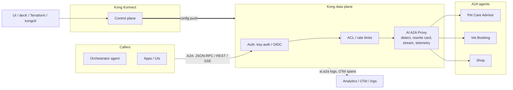

# Kong AI Gateway for A2A (Agent2Agent)

Govern agent-to-agent traffic with Kong: put Kong in front of any A2A agent to add authentication, access control, rate limits, Agent Card URL rewriting, streaming pass-through and A2A telemetry, without changing the agent.

This repo covers both ways Kong supports A2A:

| Option | Where | Min version |
| --- | --- | --- |
| **AI A2A Proxy plugin** (`ai-a2a-proxy`) on a route | API Gateway → Plugins | Kong Gateway 3.14 Enterprise |
| **AI Agent entity** (`type: a2a`) | AI Gateway 2.0 → Agents | AI Gateway 2.0 (needs a data plane) |

> The plugin reference in this repo was taken from the live schema of a Konnect control plane running **Kong Gateway 3.16.0.1 Enterprise**.

## Architecture



More diagrams: [docs/architecture.md](docs/architecture.md) (card rewrite, task flow, streaming, multi-agent, LLM + MCP + A2A on one gateway, security layers).

## Contents

| Doc | Covers |
| --- | --- |
| [docs/architecture.md](docs/architecture.md) | All architecture diagrams (PNG copies in `docs/images/`) |
| [docs/a2a-primer.md](docs/a2a-primer.md) | A2A in 5 minutes: Agent Card, tasks, methods, bindings, streaming |
| [docs/how-kong-handles-a2a.md](docs/how-kong-handles-a2a.md) | Detection, card rewriting, streaming, what Kong does and doesn't do |
| [docs/configuration-reference.md](docs/configuration-reference.md) | `ai-a2a-proxy` fields (live schema) and AI Agent entity fields |
| [docs/security.md](docs/security.md) | Key-auth, ACLs, OIDC, rate limits, upstream auth, mTLS |
| [docs/observability.md](docs/observability.md) | `ai.a2a` log fields, OpenTelemetry attributes, task states |
| [docs/clients-and-deploy.md](docs/clients-and-deploy.md) | curl, Python, agent-to-agent calls; deploy with UI, decK, Terraform, kongctl |
| [docs/troubleshooting.md](docs/troubleshooting.md) | Common errors and fixes |

| Example | What it shows | Status |
| --- | --- | --- |
| [agent/](agent/) | Dependency-free sample A2A agent (card, send, stream, tasks, REST) | Tested locally |
| [scripts/a2a-smoke-test.sh](scripts/a2a-smoke-test.sh) | card → message/send → tasks/get → message/stream | Tested against the sample agent |
| [examples/01-a2a-basic.yaml](examples/01-a2a-basic.yaml) | Plugin in front of one agent | Matches live schema |
| [examples/02-key-auth-acl.yaml](examples/02-key-auth-acl.yaml) | API keys + consumer-group ACL | Template |
| [examples/03-oidc.yaml](examples/03-oidc.yaml) | OAuth 2.0 client credentials between agents | Template |
| [examples/04-rate-limit-and-size.yaml](examples/04-rate-limit-and-size.yaml) | Rate limits and body size limits | Template |
| [examples/05-observability.yaml](examples/05-observability.yaml) | HTTP Log + OpenTelemetry | Template |
| [examples/06-multi-agent-gateway.yaml](examples/06-multi-agent-gateway.yaml) | Three agents behind one gateway | Template |
| [examples/07-ai-agent-entity.kongctl.yaml](examples/07-ai-agent-entity.kongctl.yaml) | AI Gateway 2.0 Agent entity | Template (docs-based) |
| [terraform/](terraform/) | Plugin + route via Terraform | Template; run `terraform validate` |

## Quick start

```bash
# 1. Run the sample agent and give it a public URL
python3 agent/agent.py                                   # :10000
cloudflared tunnel --url http://localhost:10000          # prints https://xyz.trycloudflare.com
./scripts/a2a-smoke-test.sh http://localhost:10000       # direct test

# 2. Put Kong in front of it
#    edit examples/01-a2a-basic.yaml: url: https://xyz.trycloudflare.com
export KONNECT_TOKEN="kpat_..."
FLAGS="--konnect-addr https://us.api.konghq.com --konnect-token $KONNECT_TOKEN --konnect-control-plane-name serverless-api-gateway-demo"
deck gateway diff examples/01-a2a-basic.yaml $FLAGS
deck gateway sync examples/01-a2a-basic.yaml $FLAGS

# 3. Test through Kong (card url should now point at the gateway)
./scripts/a2a-smoke-test.sh https://<proxy-url>/pet-agent
```

## Key facts

| Fact | Detail |
| --- | --- |
| Kong's role | Transparent proxy; it does not route between agents, merge results or store task state |
| Agent Card | `/.well-known/agent-card.json`; Kong rewrites `url` and `additionalInterfaces[].url` to the gateway address |
| JSON-RPC methods detected | `message/send`, `message/stream`, `tasks/get`, `tasks/list`, `tasks/cancel`, `tasks/resubscribe`, `tasks/pushNotificationConfig/*`, `agent/getExtendedAgentCard`; or any request with an `A2A-Version` header |
| REST binding detected | `POST /v1/message:send`, `POST /v1/message:stream`, `GET /v1/tasks/{id}`, `POST /v1/tasks/{id}:cancel`, card GET |
| Streaming | `text/event-stream` passed through unbuffered; events counted, TTFB measured |
| Plugin config | `logging.log_statistics`, `logging.log_payloads`, `logging.max_payload_size`, `max_request_body_size` |
| Telemetry | `ai.a2a.rpc[]` log fields; OpenTelemetry span `kong.a2a` |

## Related repos

- `azure-foundry-gateway`: LLM traffic (AI Proxy → Azure AI Foundry)
- `kong-ai-mcp-proxy`: MCP tools (AI MCP Proxy)

Together: one Kong gateway for models, tools and agents.

## References

- [AI A2A Proxy plugin](https://developer.konghq.com/plugins/ai-a2a-proxy/)
- [AI Agent entity](https://developer.konghq.com/ai-gateway/entities/ai-agent/)
- [Get started with AI Agent](https://developer.konghq.com/ai-gateway/get-started-with-ai-agent/)
- [A2A in AI Gateway](https://developer.konghq.com/ai-gateway/a2a/)
- [A2A protocol](https://a2a-protocol.org/latest/)
