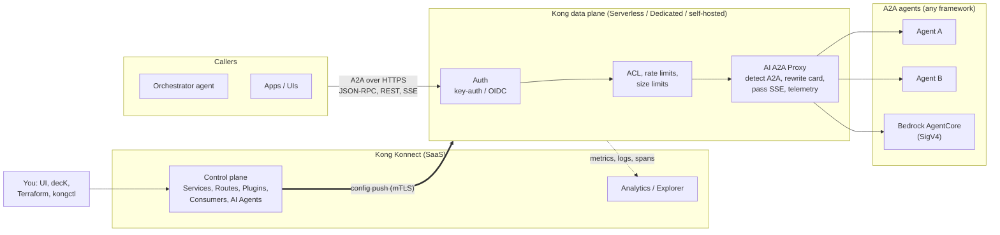
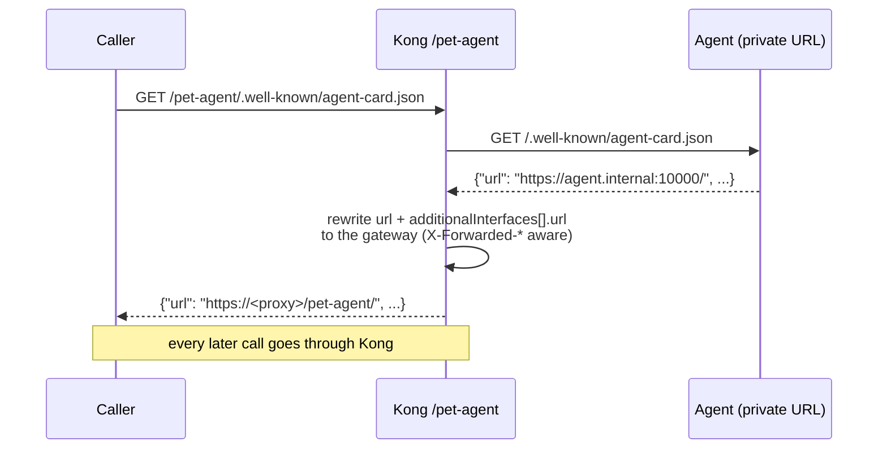
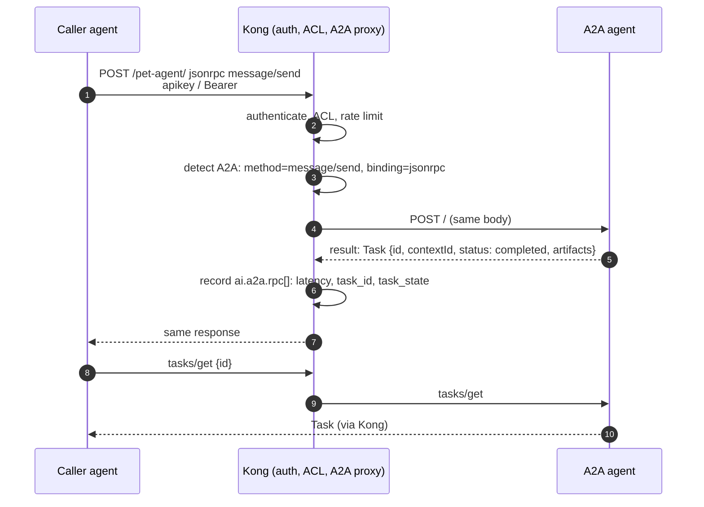
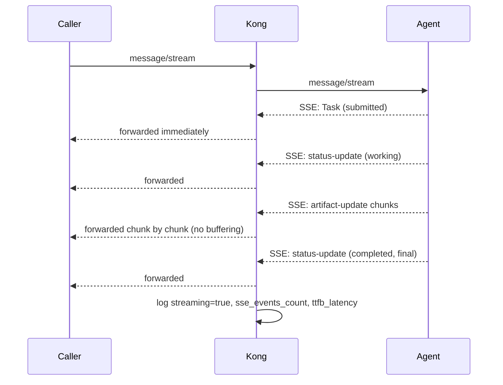
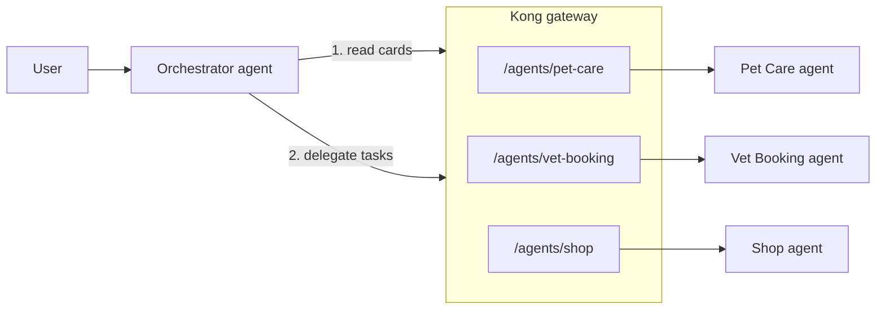
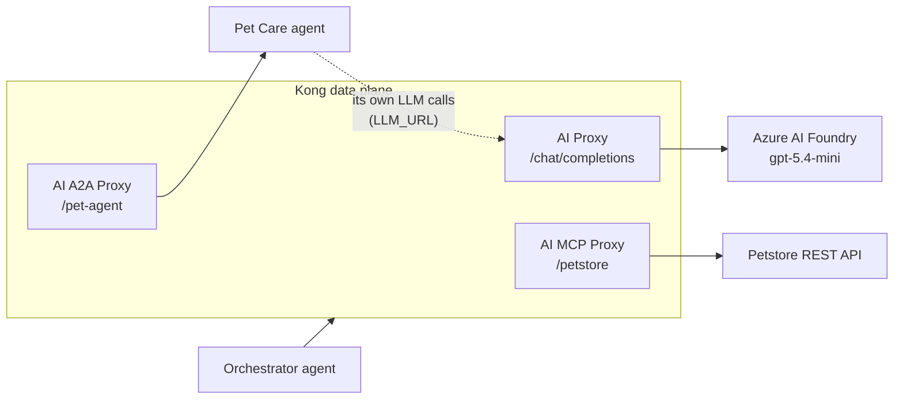
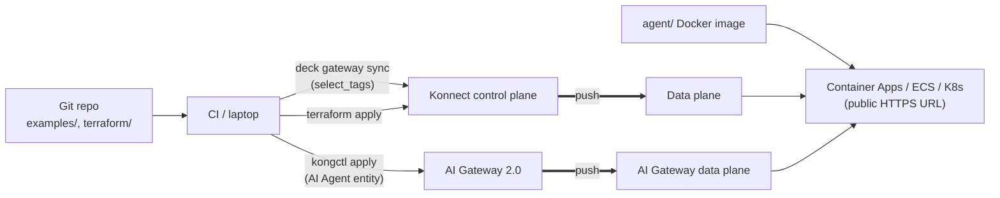
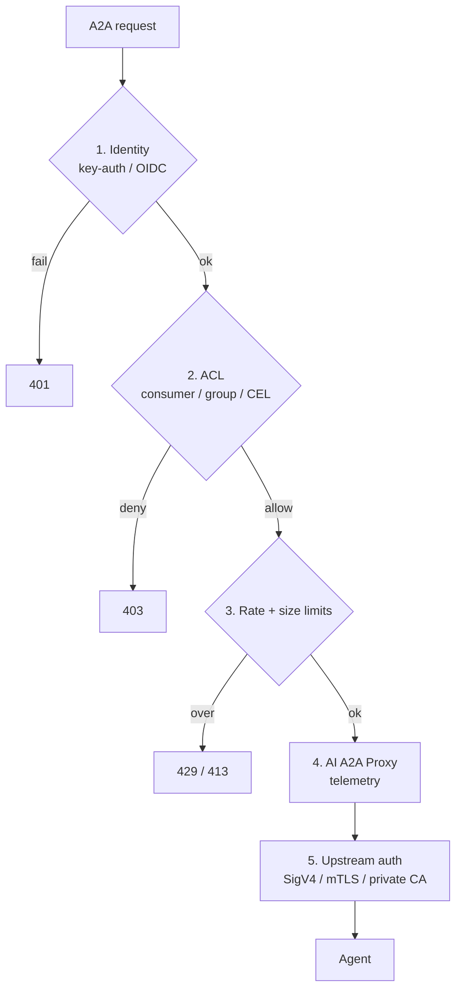

# Architecture

## 1. Big picture

| Layer | Component | Responsibility |
| --- | --- | --- |
| Callers | Orchestrator agents, apps | Discover agents (card), send tasks |
| Management | Konnect control plane | Config; never sees A2A traffic |
| Runtime | Kong data plane | Serves the proxy URL, runs plugins |
| A2A | AI A2A Proxy / AI Agent entity | Detection, card rewriting, streaming, telemetry |
| Security | key-auth / OIDC, ACL, rate limiting | Who may call which agent, how often |
| Backends | A2A agents | Do the work, own task state |

## 2. Discovery: Agent Card rewriting

Without the rewrite, a caller would read the agent's real address from the card and bypass the gateway.

## 3. A task: message/send

## 4. Streaming: message/stream

## 5. Multi-agent behind one gateway

Each route has its own policies; the orchestrator holds one gateway credential instead of one per agent.

## 6. Models, tools and agents on one gateway

| Traffic | Plugin | Typical use |
| --- | --- | --- |
| LLM | AI Proxy | The orchestrator thinks |
| MCP | AI MCP Proxy | The orchestrator uses tools |
| A2A | AI A2A Proxy | The orchestrator delegates whole tasks to other agents |

## 7. Deployment

## 8. Security layers

## PNG versions

See [images/](images/) for rendered copies of every diagram.
